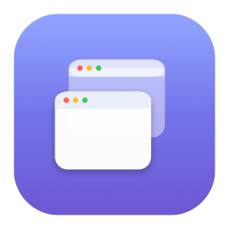

<div align="center">



# Window Memory

**ウィンドウ配置を1クリックで復元する、Mac用メニューバーアプリ**

外部モニターを外したり再接続したりすると崩れるウィンドウ配置を、いつもの状態に戻します。

[](https://github.com/lynox-llc/Window-Memory/releases)
&nbsp;


</div>

---

## ✨ 機能

- 🖥 **アプリ配置保存** — 起動中の全アプリのウィンドウ位置・サイズをまとめて記録
- ⚡️ **1クリック復元** — メニューから選ぶだけで一括復元（⌘1〜⌘9 のショートカット対応）
- 🔀 **ディスプレイごとのプロファイル** — モニター構成ごとに自動グループ化。同じ構成に戻ったときだけ、その配置が「Restore Layout」に表示されます
- 🔄 **ディスプレイ変更で自動復元（任意）** — モニターの抜き差しを検知し、その構成の最新の配置を自動で復元
- 🎯 **高精度な復元** — タイトル・ウィンドウ番号で照合し、同じアプリの複数ウィンドウにも対応
- 🇯🇵 **日本語メニュー対応**（システム言語が日本語の場合）
- 🚀 **ログイン時に自動起動**
- 🔒 **プライバシー重視** — 配置データはお使いのMac内にのみ保存。外部への送信は一切ありません（「アップデートを確認」を押したときだけ、GitHubの最新バージョン情報を取得します）
- 🪶 Dockに出ない軽量なメニューバー常駐アプリ

## 💻 動作環境

- macOS 13 以降
- Swift / AppKit 製

## 📥 インストール

1. [**Releases ページ**](https://github.com/lynox-llc/Window-Memory/releases)から最新のDMGをダウンロードして開く
2. `Window Memory` を `Applications` フォルダへドラッグ

### 🔑 初回起動の手順（重要）

このアプリはApple署名を行っていないため、初回のみセキュリティ確認を通す操作が必要です。
（2回目以降は普通にダブルクリックで起動できます）

1. `アプリケーション` フォルダの **Window Memory をダブルクリック**
   → 「開発元を確認できないため開けません」と表示されます（**正常です**）
2. **システム設定 →「プライバシーとセキュリティ」** を開き、下へスクロール
3. 「"Window Memory"は開発元を確認できないためブロックされました」の横の **【このまま開く】** をクリック
4. 確認ダイアログでもう一度 **【開く】** をクリック

> [!WARNING]
> **macOS 15 (Sequoia) 以降では、右クリック →「開く」では開けません。** 必ず上記3の **【このまま開く】** をお使いください。

> [!TIP]
> どうしても開けない場合は、ターミナルで次の1行を実行すると確実です：
> ```bash
> xattr -dr com.apple.quarantine "/Applications/Window Memory.app"
> ```

### アクセシビリティを許可（必須）

ウィンドウを操作するために許可が必要です。

**システム設定 →「プライバシーとセキュリティ」→「アクセシビリティ」→ Window Memory をオン**

> [!NOTE]
> アプリを**更新した場合は、以前の許可が無効になることがあります。** その場合はリストから一度「−」で削除し、「＋」で `/Applications/Window Memory.app` を追加し直してください。

## 🚀 使い方

1. メニューバーの **⊞ アイコン** をクリック
2. **「Save Current Layout…」（日本語表示では「現在の配置を保存…」）** で今のウィンドウ配置に名前を付けて保存
3. 配置が崩れたら **「Restore Layout」（「配置を復元」）→ 保存した名前** を選ぶだけ
4. 抜き差しのたびに自動で戻したい場合は **「ディスプレイ変更時に自動復元」** をオン

## 🛠 しくみ

macOS の Accessibility API（`AXUIElement`）で各アプリのウィンドウ位置・サイズを読み書きします。配置データの保存先は `~/Library/Application Support/WindowMemory/profiles.json`。ウィンドウの照合は「ウィンドウタイトル → ウィンドウ番号 → （そのアプリの保存が1ウィンドウのみの場合）未使用のウィンドウ」の順で行い、同じウィンドウを二重に使うことはありません。ディスプレイ構成は各画面の位置とサイズで判定します。

## ⚙️ ソースからビルド

```bash
./build.sh          # build/Window Memory.app を生成
open "build/Window Memory.app"
```

必要環境：macOS 13+ / Swift（Xcode Command Line Tools）

| ファイル | 役割 |
|---|---|
| `WindowMemory/Sources/main.swift` | アプリ本体（メニューバーUI + ウィンドウ制御 + 永続化） |
| `WindowMemory/Info.plist` | バンドル設定（`LSUIElement` = メニューバー常駐） |
| `build.sh` | ビルド & `.app` 化 |

## ❓ よくある質問

<details>
<summary>「開発元を確認できないため開けません」と出ます</summary>

正常です。上記「初回起動の手順」の **【このまま開く】** をお使いください。Apple署名（公証）を行っていないための表示で、アプリの安全性とは別の話です。
</details>

<details>
<summary>復元したのに一部のウィンドウが動きません</summary>

保存時に起動していたアプリが、復元時に起動していない場合はそのウィンドウは配置されません。対象アプリを起動してから復元してください。
</details>

## 📄 ライセンス / 開発

開発： **LYNOX LLC**
© 2026 LYNOX LLC. All rights reserved.
